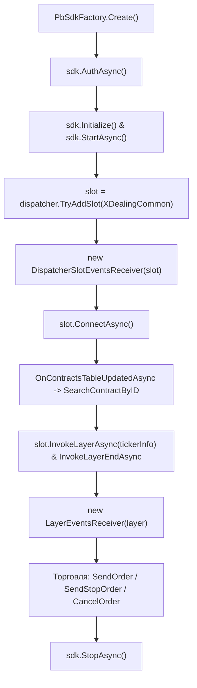

# Привод Бондаря .NET SDK (CScalp SDK)

Официальная клиентская библиотека .NET 7 для создания торговых роботов и алгоритмических систем, работающих через инфраструктуру **Привода Бондаря версии 1.0**.

Библиотека поставляется в виде скомпилированного и защищенного NuGet-пакета `PbSdk.nupkg`, переиспользующего высокопроизводительные диспетчеры ядра CScalp (`ICore`) без графических зависимостей (WPF).

---

## ⚡ Быстрый старт за 5 минут

В репозитории подготовлен готовый демонстрационный проект — **`PbSdkConsole`**, включающий подключение к проп-серверу, подписку на финансовые показатели счета, стакан котировок, ленту сделок и автоматическое выставление заявок (лимитный тейк-профит и серверный стоп-лосс).

### 1. Требования к окружению
* **ОС:** Windows 10 / 11 / Windows Server (x64)
* **Платформа:** [.NET 7.0 SDK](https://dotnet.microsoft.com/download/dotnet/7.0) (`net7.0-windows`, платформа `x64`)
* **Среда выполнения:** .NET 7 Desktop Runtime (`windowsdesktop`, x64)
* **Лицензия:** действующий файл лицензии Привода Бондаря (`cs.license`)

### 2. Размещение файла лицензии
Скопируйте ваш файл `cs.license` в рабочую папку настроек SDK:
```text
%APPDATA%\PbSdk\cs.license
```

### 3. Подключение NuGet-пакета
Пакет `PbSdk` подключается локально из папки `nupkg/` через `nuget.config` в корне решения:
```xml
<?xml version="1.0" encoding="utf-8"?>
<configuration>
  <packageSources>
    <add key="nuget.org" value="https://api.nuget.org/v3/index.json" protocolVersion="3" />
    <add key="local-pbsdk" value="nupkg" />
  </packageSources>
</configuration>
```

В файле `PbSdkConsole/PbSdkConsole.csproj` уже настроена ссылка на пакет:
```xml
<ItemGroup>
  <PackageReference Include="PbSdk" Version="0.1.32" />
</ItemGroup>
```

### 4. Настройка учетных данных и тикера в PbSdkConsole/Program.cs
Откройте файл `PbSdkConsole/Program.cs` и укажите реквизиты вашего счета Привода Бондаря и код инструмента в начале файла:
```csharp
string _findStockLongName = "YOUR_SERVER_NAME"; // Название сервера из справочника слота
string _account = "YOUR_LOGIN";              // Логин от торгового счета ПБ
string _password = "YOUR_PASSWORD";          // Пароль от торгового счета ПБ

string _tickerSecurityID = "TQBR.GAZP";      // Уникальный идентификатор инструмента (SecurityID)
```

### 5. Сборка и запуск
В терминале выполните:
```bash
dotnet restore
dotnet run --project PbSdkConsole
```

При успешном подключении консоль выведет этапы старта, финансовые данные счета и запустит демонстрационный цикл ожидания позиции по выбранному инструменту:
```text
Creating...
Created
Authorization...
Authorized
Starting...
Started
Slot: OnConnected
Slot: OnContractsTableUpdated
Slot: OnFinDataUpdate
Layer (GAZP): OnReplicationBegin
Layer (GAZP): OnReplicationEnd
LayerTradingSample_1
LayerTradingSample_1: Waiting for PositionAmount > 0
```

---

## 🧱 Архитектура и жизненный цикл (PbSdkConsole)

Работа с SDK строится на двух уровнях: **уровень подключения (`IDispatcherSlot`)** и **уровень конкретного инструмента (`ILayer`)**.



### Порядок вызовов:
1. **`PbSdkFactory.Create()`** — создание экземпляра фасада `IPbSdkManager`.
2. **`await sdk.AuthAsync()`** — проверка подлинности и валидация файла `cs.license`.
3. **`sdk.Initialize()` и `await sdk.StartAsync()`** — инициализация модулей ядра и запуск сетевых служб.
4. **Настройка слота (`IDispatcherSlot`):** получение `sdk.PrivodBondarDispatcher`, создание слота `DispatcherSlotType.XDealingCommon` и регистрация получателя событий `DispatcherSlotEventsReceiver`.
5. **`slot.ConnectAsync()`** — подключение к выбранному серверу из `slot.PublicServersInfo`.
6. **Создание слоя инструмента (`ILayer`):** после прихода события `OnContractsTableUpdatedAsync` выполняется поиск тикера `slot.ContractsTable.SearchContractByID("TQBR.GAZP")`, вызов `slot.InvokeLayerAsync(...)`, подписка `LayerEventsReceiver` и обязательный завершающий вызов `slot.InvokeLayerEndAsync(...)` для запуска репликации портфеля по инструменту.
7. **Торговые операции:** после готовности слота и слоя (`slot.IsReady`, `layer.IsReplicationsDone`, `layer.IsStockReceived`) выполняются методы `layer.SendOrder(...)`, `layer.SendStopOrder(...)`, `layer.CancelOrder(...)` и `layer.CancelStopOrder(...)`.
8. **`await sdk.StopAsync()`** — корректное завершение работы, сохранение конфигурации слотов и закрытие соединений.

---

## 📡 Двухуровневая модель событий

В проекте `PbSdkConsole` обработка разделена на два специализированных класса:

### 1. События подключения и счета (`DispatcherSlotEventsReceiver.cs`)
Реализует `IDispatcherSlotEventsReceiver`:
* **`OnConnected` / `OnConnectionFailed` / `OnDisconnected`** — управление состоянием TCP-сессии.
* **`OnContractsTableUpdatedAsync`** — сигнал готовности справочника инструментов `slot.ContractsTable`, после которого можно создавать слои `ILayer`.
* **`OnFinDataUpdate`** — потоковое обновление финансовых показателей счета (`TotalAssets`, `FreeAssets`, `BlockedAssets`, `PnL`, `Commission`, `MarginCall`) по битовой маске `slot.FinDataUpdateSchema`.

### 2. События инструмента, стакана и заявок (`LayerEventsReceiver.cs`)
Реализует `ILayerEventsReceiver`:
* **`OnReplicationBegin` / `OnReplicationEnd`** — начало и окончание первичной синхронизации активных позиций, сделок и заявок по тикеру.
* **`OnStockUpdate`** — обновление биржевого стакана (`ContractOrderStock`: `BestBid`, `BestAsk`, массивы `Bids`/`Asks`).
* **`OnTick`** — поток обезличенных рыночных сделок (лента тиков `TickGraphicData`).
* **`OnPositionUpdate` / `OnTrade` / `OnClosingTrade`** — изменение открытой позиции (`layer.Posmonitor`) и собственные сделки пользователя.
* **`OnLimitOrdersChanged` / `OnLimitOrderOpFailed`** — состояние активных лимитных заявок (`layer.Lomonitor._List`) и коды ошибок выставления/снятия.
* **`OnStopOrdersChanged` / `OnStopOrderOpFailed`** — состояние серверных стоп-заявок (`layer.Somonitor._List`) и коды ошибок.

> [!IMPORTANT]
> Все обратные вызовы приходят из фоновых потоков диспетчера. При итерации по массивам уровней стакана (`stock.Asks` / `stock.Bids`) в `OnStockUpdate` обязательно используйте блокировку `lock (stock)` и проверку `if (!stock.IsDisposed)`.

---

## 🔐 Передача данных

SDK передает на серверы правообладателя данные для проверки лицензии и статистику использования. Подробнее: [PRIVACY.md](PRIVACY.md).

---

## ⚠️ Известные ограничения

* SDK собран под .NET 7. Поддержка .NET 7 со стороны Microsoft завершена, при сборке появится предупреждение `NETSDK1138`.
* При восстановлении пакетов `dotnet` может сообщить об известных уязвимостях в транзитивных зависимостях: `DotNetZip 1.16.0`, `System.Formats.Asn1 5.0.0`, `System.Text.Json 7.0.2` (High), `RestSharp 110.2.0` (Moderate).

---

## 📚 Структура документации проекта

Для детального изучения устройства SDK используйте специализированные руководства:
* [`docs/01_getting_started.md`](docs/01_getting_started.md) — Установка, лицензия `cs.license`, настройка NuGet и подключение к серверу ПБ 1.0.
* [`docs/02_lifecycle.md`](docs/02_lifecycle.md) — Жизненный цикл `IPbSdkManager`, `IDispatcherSlot`, создание слоев `ILayer` и условия готовности к торговле.
* [`docs/03_event_handling.md`](docs/03_event_handling.md) — Обработка финансовых данных, потокобезопасное чтение стакана, тиков, позиций и заявок.
* [`docs/04_api_reference.md`](docs/04_api_reference.md) — Справочник интерфейсов, методов выставления/отмены лимитных и стоп-заявок (`SendOrder`, `SendStopOrder`, `CancelOrder`).
* [`docs/05_troubleshooting.md`](docs/05_troubleshooting.md) — Диагностика и решение типовых проблем при разработке роботов.

---

## 🤖 Для ИИ-ассистентов и автономных агентов

Если вы используете Cursor, Copilot, Windsurf, Claude Code или другие ИИ-агенты для написания торговых роботов на базе `PbSdk`:
* Машиночитаемый индекс репозитория: [`llms.txt`](llms.txt)
* Полная спецификация инвариантов и сигнатур для ИИ-агентов: [`AGENTS.md`](AGENTS.md)

---

## ✉️ Поддержка

Все вопросы и обращения: [support@in.fsr-develop.com](mailto:support@in.fsr-develop.com).

---

## 📄 Лицензия

Бинарные файлы SDK (`PbSdk.nupkg`) можно бесплатно использовать для любых целей без изменения кода. Документация и примеры распространяются по лицензии MIT. Подробнее: [LICENSE](LICENSE).

SDK, документация и примеры предоставляются «как есть», без каких-либо гарантий. Все риски, связанные с их использованием, включая ошибки, уязвимости и торговые потери, несет пользователь.

© 2026 BAVInvest Ltd
